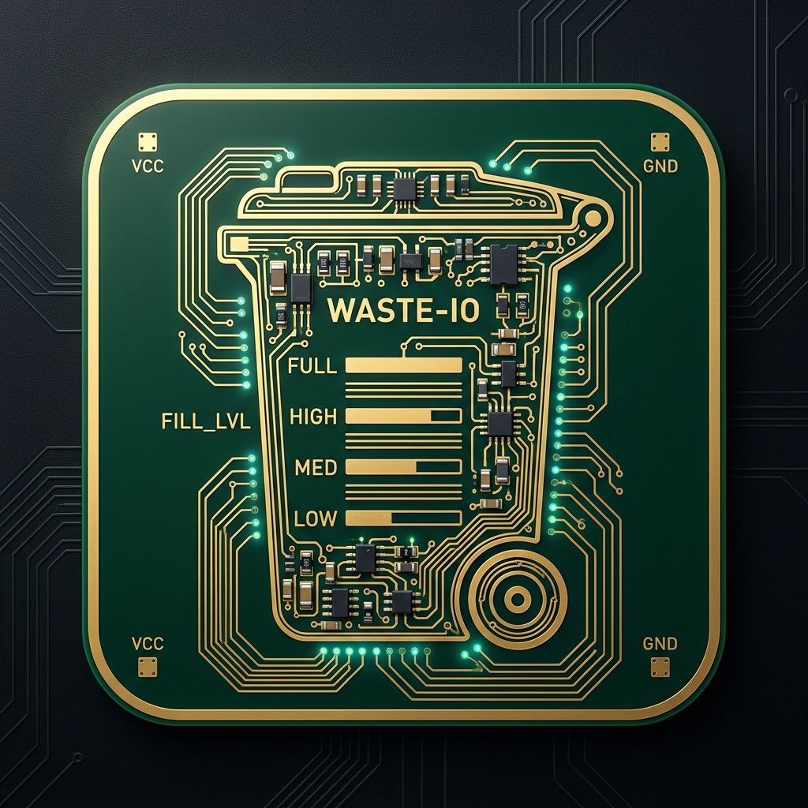
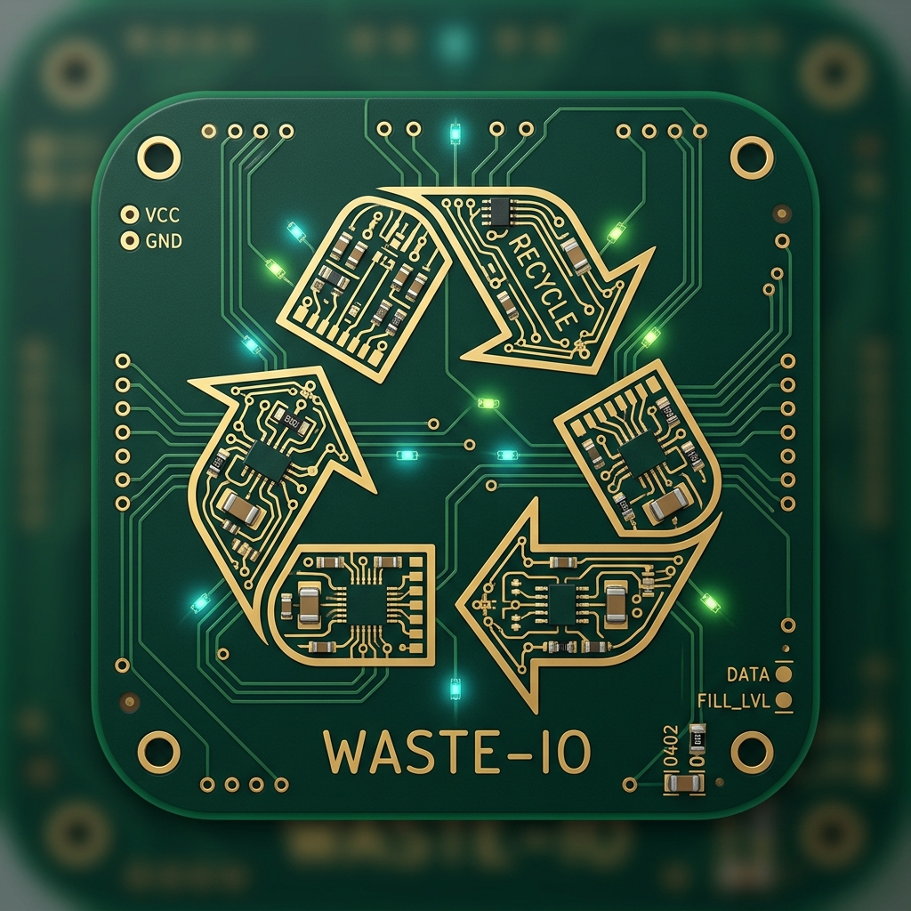

<p align="center">
  
</p>

<h1 align="center">WasteControl-io</h1>

<p align="center">
  <b>Intelligent Waste, Recycling, Compost & Bin Telemetry Orchestration for Home Assistant</b><br>
  <i>Part of the Paradigm-Paradox <code>*-io</code> Smart Homestead Ecosystem</i>
</p>

<p align="center">
  
  
  
  
</p>

---

## 📋 Overview

**WasteControl-io** coordinates solid waste, recycling, compost, and hazardous waste logistics for residences, estates, and homesteads. It synchronizes municipal and private collection schedules, monitors bin fill levels and location status in real-time via IoT/ESP32 edge nodes, and integrates natively into Home Assistant with MQTT Auto-Discovery, actionable notifications, and an Ingress web dashboard.

---

## 🚀 Key Features

- **🚛 Dynamic Multi-Stream Collection Scheduling**:
  - Flexible cadence engines: Weekly, alternate weeks (odd/even), monthly, and custom day rotations.
  - Automatic holiday delay compensation (+1 day shifts for Thanksgiving, Christmas, Memorial Day, Labor Day, etc.).
  - Multi-stream tracking: General Trash, Single/Dual Stream Recycling, Yard Waste, Food/Organics, Bulk Pickup, Hazardous/E-Waste.
  - Native Home Assistant Calendar entity synchronization.

- **📊 Smart Bin IoT Telemetry & Tracking**:
  - Continuous fill-level percentage via ESP32 ultrasonic / ToF distance sensors.
  - Presence & Location tracking: `storage`, `transit`, `curb` using Bluetooth LE beacons, Zigbee, or contact sensors.
  - Lid open/closed status detection with tilt sensors and anti-flicker debouncing.
  - Battery state of charge (SoC) monitoring for battery/solar-powered bin nodes.

- **🏡 Native Home Assistant Integration**:
  - Zero-configuration MQTT Auto-Discovery (Sensors, Binary Sensors, Buttons, Calendars).
  - Supervisor Core API integration for two-way entity sync.
  - Actionable notifications ("Take cans to the curb", "Bring cans back in", "Bin full warning").
  - Responsive Ingress Web Dashboard embedded directly in the Home Assistant sidebar.

- **⚡ Distributed ESP32 Edge Firmware**:
  - Turnkey ESPHome firmware configurations for low-power, weather-resistant bin monitors.
  - Deep-sleep battery operation with wake-on-motion / periodic ultrasonic telemetry.

---

## 📁 Repository Structure

```text
├── waste_control/               # Complete Home Assistant Add-on
│   ├── app/                     # Python FastAPI server & waste engine
│   │   ├── engine/              # Schedule calculations & bin state manager
│   │   ├── config.py            # Options loader & Pydantic models
│   │   ├── ha_client.py         # Home Assistant Supervisor API client
│   │   ├── templates/           # Ingress dashboard HTML/CSS
│   │   └── main.py              # Application entrypoint & REST API
│   ├── config.yaml              # Add-on configuration & options schema
│   ├── build.yaml               # Multi-arch container base images
│   ├── Dockerfile               # Production container definition
│   ├── run.sh                   # Add-on startup entrypoint
│   ├── DOCS.md                  # Detailed user guide
│   └── CHANGELOG.md             # Version history
├── firmware/                    # ESP32 edge microcontroller firmware (ESPHome)
│   ├── esp32/
│   │   ├── bin_ultrasonic_distance.yaml   # Ultrasonic fill level node
│   │   ├── bin_ble_presence_tracker.yaml  # BLE presence & curb beacon
│   │   └── README.md                      # Hardware wiring & flashing guide
├── docs/
│   ├── DESIGN.md                # System design & architecture specification
│   └── assets/                  # PCB art branding and schematics
├── DESIGN.md                    # Architecture summary
├── repository.yaml              # HA Add-on Repository manifest
└── README.md
```

---

## 📦 Installation in Home Assistant

1. In your Home Assistant instance, navigate to **Settings** -> **Add-ons** -> **Add-on Store**.
2. Click the three dots (top right) -> **Repositories**.
3. Add this repository URL:
   ```text
   https://github.com/Paradigm-Paradox/WasteControl-io
   ```
4. Find **WasteControl-io** in the add-on store list and click **Install**.
5. Configure your waste streams and collection days in the **Configuration** tab.
6. Click **Start** and select **Show in sidebar** to access the Ingress dashboard.

---

## 🎨 Branding & PCB Art Identity

WasteControl-io features a custom PCB art identity crafted with an exposed immersion gold (ENIG) trace aesthetic on dark matte solder mask, matching the broader `*-io` smart homestead hardware suite.

| Smart Bin Telemetry (Concept A) | Universal Recycling Loop (Concept B) |
| :---: | :---: |
|  |  |

---

## 📄 License

This project is licensed under the MIT License - see the [LICENSE](LICENSE) file for details.
