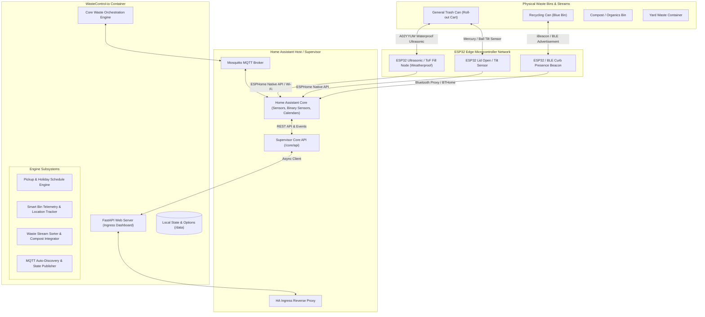

# WasteControl-io: System Design & Architecture Specification

## 1. Executive Summary & Vision

**WasteControl-io** is an edge-native, intelligent Home Assistant Add-on and waste orchestration engine. It coordinates solid waste, recycling streams, organic composting loops, hazardous material disposition, and distributed **ESP32 IoT bin nodes**.

Rather than relying on static calendar reminders or manual routines, WasteControl-io synchronizes real-time physical bin states (fill percentages, curb presence, lid status) with collection logistics and holiday exception schedules, providing closed-loop waste automation directly inside Home Assistant.

---

## 2. High-Level Architecture

---

## 3. Core Engine Subsystems

### 3.1 Dynamic Schedule & Holiday Engine
The schedule engine computes real-time collection countdowns for every configured stream:
- **Recurrence Models**:
  - `weekly`: Repeats every 7 days on the specified day of week.
  - `biweekly_even` / `biweekly_odd`: Evaluated against ISO week number ($W_{iso} \pmod 2$).
  - `monthly`: First occurrence of designated day in the month.
  - `custom`: Explicit date lists or recurring interval days.
- **Holiday Delay Rules**:
  - If a recognized municipal holiday falls on or before collection day within the same week, pickup shifts by $+1$ day.
  - Standard supported holidays: New Year's Day, Memorial Day, Independence Day, Labor Day, Thanksgiving, Christmas Day.

### 3.2 Smart Bin Telemetry & Fill Modeling
The bin tracking engine translates ultrasonic or Time-of-Flight (ToF) sensor distance measurements into accurate volume percentages:
$$\text{Fill Level (\%)} = \text{clamp}\left(\frac{D_{\text{empty}} - D_{\text{sensor}}}{D_{\text{empty}} - D_{\text{full}}} \times 100, 0, 100\right)$$
Where:
- $D_{\text{empty}}$: Distance from sensor (lid mounted) to empty bottom of bin (default $95\text{ cm}$).
- $D_{\text{full}}$: Distance from sensor to fill threshold line (default $15\text{ cm}$).
- $D_{\text{sensor}}$: Real-time ultrasonic ping measurement.

### 3.3 Presence & Location Tri-State Logic
Tracks physical bin location through three distinct operational states:
1. `storage`: Bin is parked in garage, side yard, or docking station.
2. `curb`: Bin has been rolled out to the street/curb for collection.
3. `transit`: Bin is moving or detected away from both home dock and curb beacon.

---

## 4. Hardware Specifications & Edge Nodes

### ESP32 Weatherproof Bin Fill Sensor (Node 1)
- **Microcontroller**: ESP32-C3 or ESP32-S3 (low-power, Wi-Fi 4 + BLE 5).
- **Distance Sensor**: A02YYUW or JSN-SR04T waterproof ultrasonic transducer ($20\text{ cm} - 450\text{ cm}$ range).
- **Power**: 18650 Li-ion cell ($3.7\text{ V}$) with TP4056 USB-C solar charge controller and $1\text{ W}$ solar panel mounted on bin lid.
- **Sleep Strategy**: Deep sleep drawing $<15\mu\text{A}$, waking every 30 minutes or immediately on accelerometer tilt.

---

## 5. Home Assistant Integration Contract

### MQTT Auto-Discovery Entities
For each configured stream (e.g. `trash`, `recycling`), WasteControl-io automatically creates:
| Entity Type | Domain | Name | Purpose |
| :--- | :--- | :--- | :--- |
| Sensor | `sensor` | `Days Remaining` | Countdown in days until next scheduled collection |
| Sensor | `sensor` | `Next Pickup Date` | ISO date string of next collection |
| Sensor | `sensor` | `Bin Fill Level` | Real-time percentage fill ($0 - 100\%$) |
| Sensor | `sensor` | `Bin Location` | State string: `storage`, `curb`, `transit` |
| Binary Sensor | `binary_sensor` | `Collection Today` | `on` if pickup is scheduled today |
| Binary Sensor | `binary_sensor` | `Curb Status Check` | `off` if pickup is tomorrow but bin is still in storage |
| Button | `button` | `Mark At Curb` | Instant action to set location to curb |
| Button | `button` | `Mark At Storage` | Instant action to set location to storage |
